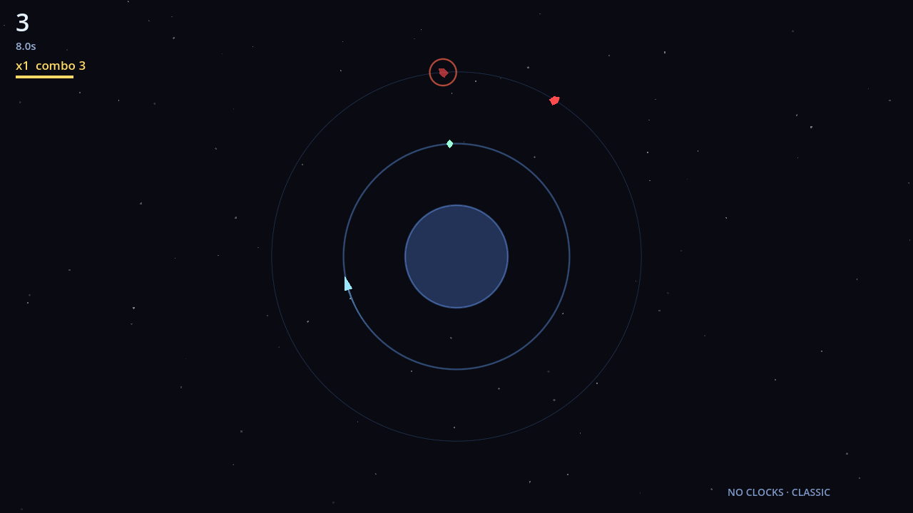
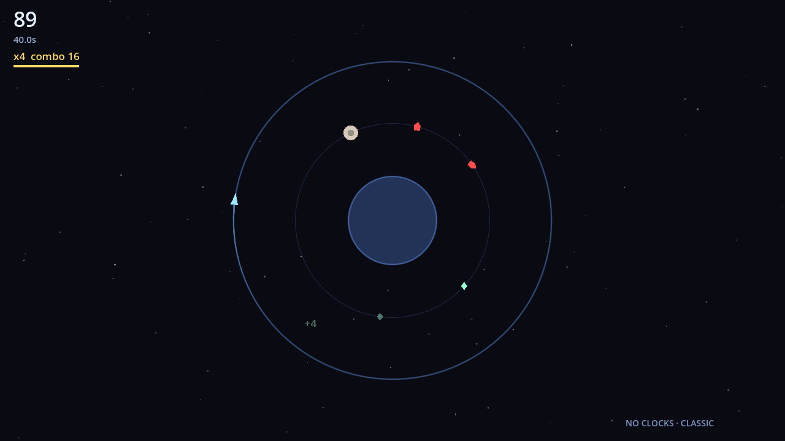

# Orbit Dash — Godot port

A Godot 4.7 port of [zerodev.games/orbit-dash](https://zerodev.games/orbit-dash/)
(`GAME_VERSION = 122`), built headlessly as an engine-capability experiment.

**Play:** https://petershk.github.io/orbit-dash-godot/

Tap / click / **Space** swaps the ship between the two rings. Collect gems, graze
the red debris as close as you dare, avoid the moon. Press **G** on the title or
game-over screen to toggle DODGE ONLY (debris only, closer grazes pay more).

## What was ported

The whole deterministic core loop, formula-for-formula from the JS original:

- `mulberry32` daily PRNG with the **exactly-5-rolls-per-spawn-attempt** invariant,
  reimplemented with uint32-faithful `imul`
- ship motion (`omegaAt`, the DEEP ORBIT log tail), exponential radius easing
  with the clamped `min(1, dt*10)` step, the arrival latch
- `SWAP_CD = 0.18` swap commitment and the v96 quick-undo (once per crossing)
- spawn cadence, wave/calm `debrisChance` curves, sub-types (gem/star/comet/clock),
  spawn-angle lead scaled by `omega()`
- both anti-trap guards: spawn-time (incl. the moon evaluated at the ship's
  *arrival* time) and the per-frame drifting-moon guard at the 360 px reference
- device-parity scaling (`devScale`) on every lethal and graze threshold, so the
  v69/v70/v74 fairness fixes are present from the start
- grazing: window above the lethal floor, perfect tier, streak bonus (cap 8),
  double-graze sandwich + moon-and-debris, 10 s fever doubling
- combo/multiplier/shield economy, clock rewind with every `runTime` checkpoint
  rewound in lockstep, boss waves, the 7-entry daily mutator pool

Deliberately **not** ported: `GF` telemetry, the shared ZLB leaderboard,
changelog UI, attract-mode demo. Sound is synthesised at runtime into
`AudioStreamWAV` — no asset files anywhere, the whole game is one script.

## Tests

```
godot --headless --audio-driver Dummy --script tests/sim_test.gd
```

A policy table rather than a pass/fail smoke test — it drives whole sessions
under four policies and asserts the **ordering**, not absolute scores:

```
  nothing   survival   6.78s   score    3.0   denied 0
  mash      survival   9.09s   score    7.4   denied 5940
  blind     survival   8.53s   score    4.0   denied 0
  skilled   survival  34.30s   score   52.3   denied 0
```

- do-nothing dies around 6 s — the original's spec predicts ~6 s, which is the
  main evidence the port is faithful rather than merely plausible
- mashing every frame hits the cooldown 5940 times and still loses to the
  lookahead bot by 3.8x, so the swap commitment is doing its job
- skilled beats same-effort blind by >1.5x on both survival and score, so it is
  *correct* input that matters, not activity
- the same day-seed replays an identical run, byte-for-byte

## Screenshots




## Building

```
godot --headless --export-release Web build/index.html
```

Exported with `thread_support=false`, so it needs no COOP/COEP headers and runs
on plain static hosting. For local testing `serve.py` sets them anyway.
